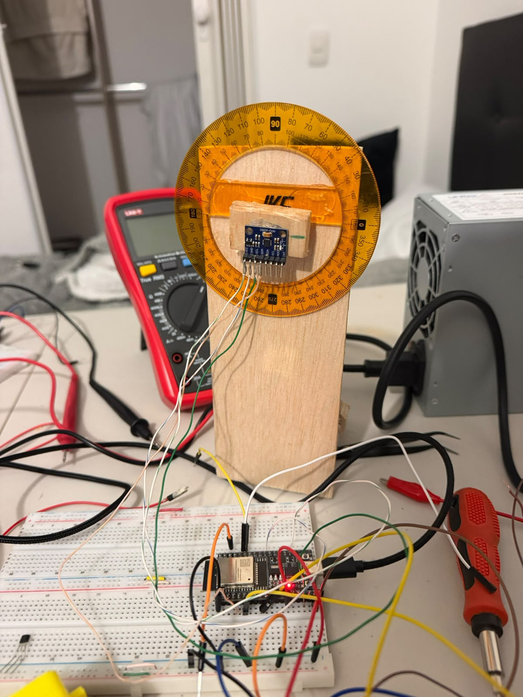
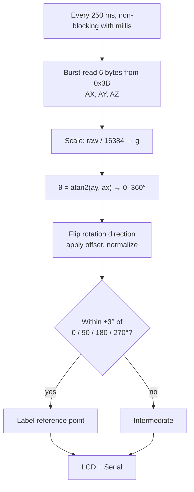

# MEMS Inclinometer: MPU6050 + ESP32 (0–360°)

A digital inclinometer that measures the angular position of a rotating disc over the full **0–360°** range, using gravity as the reference. A **MPU6050** MEMS accelerometer is read over I²C by an **ESP32**, and the angle is shown on a 16×2 LCD with **0.1°** resolution. A protractor fixed to the disc serves as the reference for checking the reading.

> Lab project, Sensors & Instrumentation, B.Sc. Mechatronics Engineering, Universidad Militar Nueva Granada. Team of 3 students.

## How it works

The disc rotates in a vertical plane, so gravity projects onto the sensor's X and Y axes. The angle is

$$\theta = \operatorname{atan2}(a_y,\ a_x)$$

The firmware then maps it to 0–360°, flips the sign to match the protractor's direction, applies a calibration offset, and normalizes the result with `fmodf`.

### Instrument parameters

| Parameter | Value |
|---|---|
| Range | 0–360° |
| Accelerometer full scale | ±2 g (16 384 LSB/g) |
| Sensor resolution near 1 g | ≈ 0.0035° |
| Display resolution | 0.1° |
| Update rate | 4 Hz (250 ms) |
| I²C | SDA GPIO21, SCL GPIO22, 50 kHz |
| Addresses | MPU6050 0x68, LCD 0x27 |

### MPU6050 registers used

| Register | Addr | Why |
|---|---|---|
| `PWR_MGMT_1` | 0x6B | Write 0x00: the chip boots in sleep mode; this wakes it on the internal 8 MHz clock |
| `ACCEL_XOUT_H` | 0x3B | Read 6 consecutive bytes (AX, AY, AZ, high/low) in a single transaction |
| `ACCEL_CONFIG` | 0x1C | Left at 0x00 (±2 g): when measuring only gravity this is the most sensitive range that does not saturate |

The I²C clock is lowered to 50 kHz to make the long protoboard wiring more robust.

## Bonus: 3D attitude viewer (MATLAB)

`matlab/mpu6050_3d_attitude_viewer.m` comes from a related Microcontrollers lab. It reads 7 comma-separated values (`ax,ay,az,gx,gy,gz,temp`) at 20 Hz from the ESP32, plots them live, and rotates a 3D airplane model:

- roll and pitch from the accelerometer, `atan2(ay, az)` and `atan2(−ax, √(ay²+az²))`
- yaw from integrating the gyro's Z axis, with a noise dead-band
- a Z-Y-X Euler rotation matrix applied to the airplane's vertices

The ESP32 firmware that streams this 7-value format is not included in this repo.

## Run it

1. Arduino IDE → board **ESP32 Dev Module**. Install the library **LiquidCrystal I2C** (Frank de Brabander).
2. Flash `firmware/inclinometer/inclinometer.ino` and open the Serial Monitor at 115200 baud.
3. With the disc at 0°, adjust `OFFSET_ANGULO` if the reading is off.

## What I learned

- Configuring a MEMS sensor straight through its registers, using the datasheet to justify every value.
- Using `atan2` for full-quadrant angles, and calibrating the sign convention and offset against a physical reference.
- Non-blocking timing with `millis()` and formatting fixed-width text for a character LCD.

---

<b>🇪🇸 Versión en español</b>

## Inclinómetro MEMS con MPU6050 y ESP32 (0–360°)

Inclinómetro digital que mide la posición angular de un disco giratorio entre 0 y 360°, tomando la gravedad como referencia. El ESP32 lee el acelerómetro MPU6050 por I²C, calcula el ángulo con `atan2(ay, ax)` y lo muestra en una LCD 16×2 con resolución de 0,1°. Para verificar la medida se acopló un transportador al disco.

Práctica de Sensores y Laboratorio, Ingeniería Mecatrónica, UMNG. Grupo de 3 estudiantes.

- **Registros:** `PWR_MGMT_1` (0x6B) para despertar el sensor, lectura en ráfaga desde `ACCEL_XOUT_H` (0x3B) y rango de ±2 g.
- **Algoritmo:** escala a g, `atan2`, corrección del sentido de giro, offset de calibración, normalización y detección de los puntos de 0, 90, 180 y 270° con una tolerancia de ±3°.
- **Extra:** visualizador 3D en MATLAB que calcula roll, pitch y yaw a partir del MPU6050 y rota un modelo de avión.

